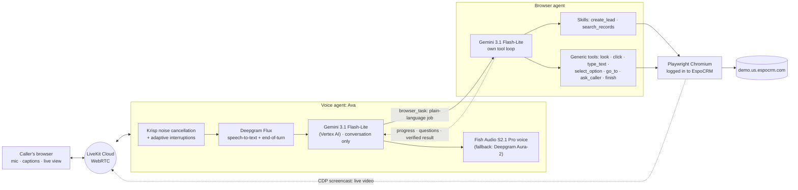

# espo-voice-agent

**Ava** is a voice agent for a CRM. You talk to her in the browser; she confirms what you want, and a second
agent does it in the real [EspoCRM demo](https://demo.us.espocrm.com/) by driving a Chromium browser that you
watch live: adding leads, updating records, scheduling meetings, converting leads, answering questions.

**Live demo:** <https://34-186-111-176.sslip.io>  ·  **Technical notes:** [`docs/technical-notes.pdf`](docs/technical-notes.pdf)

> Try: *"Add Jane Doe from Acme Robotics, phone 415 555 0142, email jane dot doe at acme dot com."*
> Then: *"Change her title to Head of Sales."* or *"Schedule an intro call with her on Tuesday at 3 pm."*

## How it works



- **Two agents, two jobs.** Ava only talks. Every CRM job goes to the browser agent in plain language and runs
  in the background, so Ava keeps the conversation going, relays the browser agent's questions ("two Jane Does,
  which one?") and phrases its results herself.
- **The browser agent sees the page as text.** Each step it gets a compact outline of the visible page (headings,
  field labels and values, every control with a ref, checkbox states, dropdown options) and acts by ref. Nothing
  in these tools is EspoCRM-specific; common jobs use faster scripted skills.
- **Writes are guarded and verified.** Ava reads every change back and needs a clear "yes" (checked in code, not
  just the prompt); the browser agent re-reads the saved record before reporting; Ava only states what the
  verified result says, and every reply is grounded in the job's real status.
- **No deletes, no mass actions,** by rule.

## Results (all reproducible, see `evals/`)

| Eval | What it checks | Latest |
|---|---|---|
| Unit tests | confirmation guard, read-back compare, tag stripping, agent hand-offs | 23/23 |
| Conversation eval | Ava's tool choice and arguments on 37 ASR-style dialogues, run twice | 74/74, first token 0.58 s median |
| Browser tasks | 16 real jobs on EspoCRM (create, duplicate, edits, ambiguity, account, contact, task, meeting, opportunity, convert, count), checked via the REST API | 16/16, 7.5 s median |
| Simulated calls | full voice loop with an LLM caller speaking into the room | 2/4 latest (one real ASR/read-back miss, one lost-audio harness failure; see notes) |

Measured on real calls: **~1.5 s median** from the caller going quiet to Ava speaking (end-of-turn ~0.4 s,
LLM first token ~0.6 s, voice first audio ~0.25 s). A new lead is saved and verified in ~4.5 s; edits take 7–10 s
while Ava keeps talking.

## Run it

Python 3.12, [uv](https://docs.astral.sh/uv/), a LiveKit Cloud project, a Deepgram key, and a GCP project with
Vertex AI (Application Default Credentials).

```bash
uv sync
uv run playwright install chromium
uv run python -m espo_voice_agent.agent download-files   # VAD weights

mkdir -p ~/.config/espo-voice-agent && cp .env.example ~/.config/espo-voice-agent/.env
chmod 600 ~/.config/espo-voice-agent/.env                 # then fill it in

scripts/dev.sh start          # agent worker + web page on http://127.0.0.1:8790
```

Production (what the live demo runs): `Dockerfile` + `deploy/compose.yaml` (app + Caddy for HTTPS) on a GCP
`c3-standard-4` in `us-east4`, secrets in `/etc/espo-voice-agent.env`.

```bash
uv run pytest                                              # unit tests
uv run python evals/llm_eval.py --models vertex/gemini-3.1-flash-lite
uv run python evals/browser_tasks.py                       # drives the real demo CRM, cleans up after itself
uv run python evals/sim_call.py --all                      # needs a running agent
```

## Layout

```
src/espo_voice_agent/
  agent.py          voice agent (Ava): session, hand-off tools, job status, confirmation guard, call logs
  browser_agent.py  browser agent: page outline, generic tools, skills, tool loop on Vertex
  espo.py           Playwright driver: login, scripted create/verify, search, duplicate check
  expressive.py     emotion cues for the voice, stripped from captions and the fallback voice
  screen.py         CDP screencast -> LiveKit video track
  prompt.py         Ava's instructions and greeting
  web.py            demo page + token endpoint (rate limit, concurrent-call cap)
  static/           the demo page
evals/              conversation eval, browser-task eval, simulated calls, voice samples, results
tests/              unit tests
deploy/, Dockerfile production setup
```
